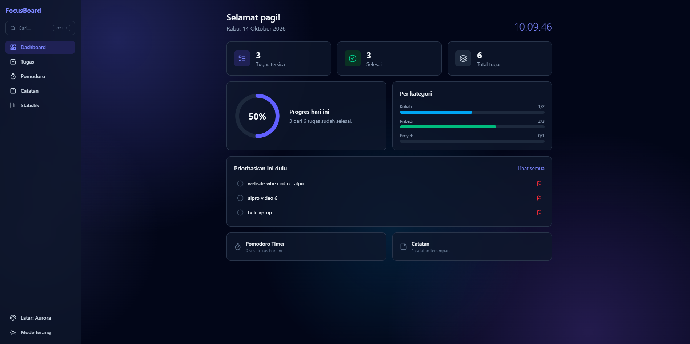
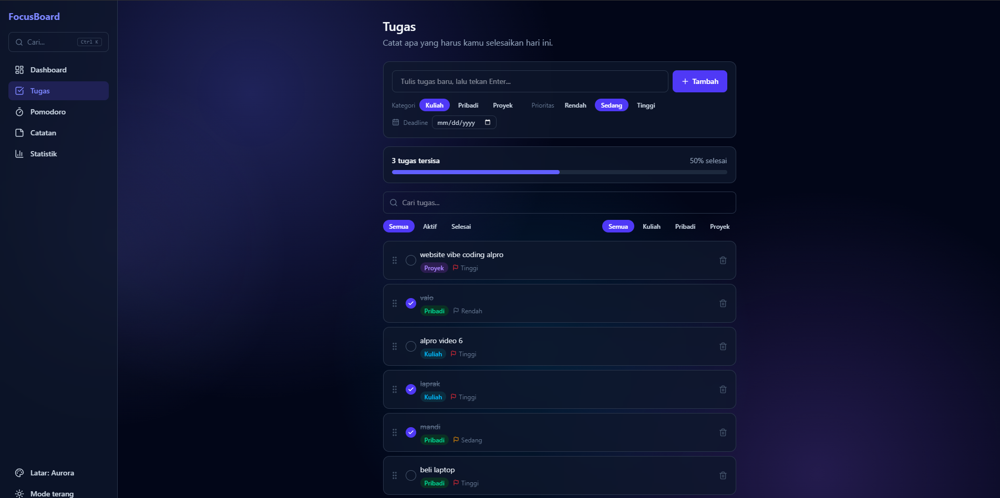
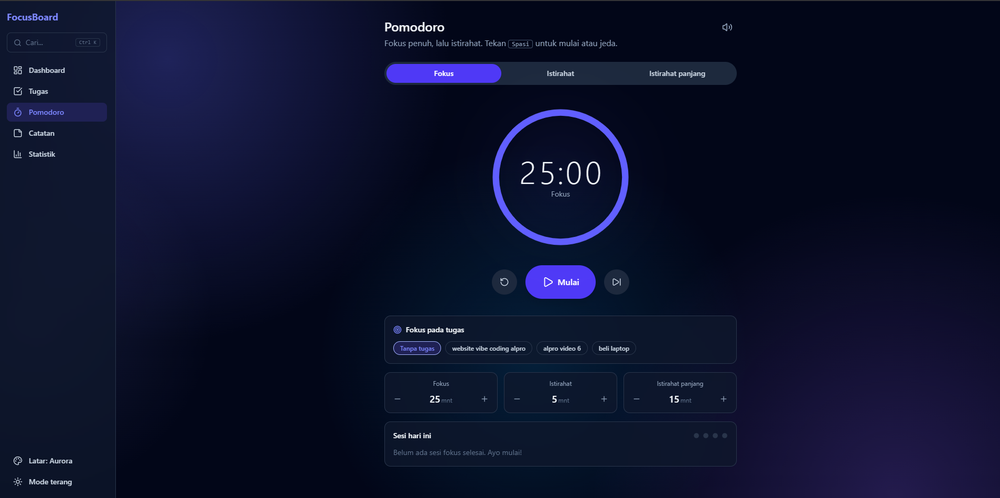
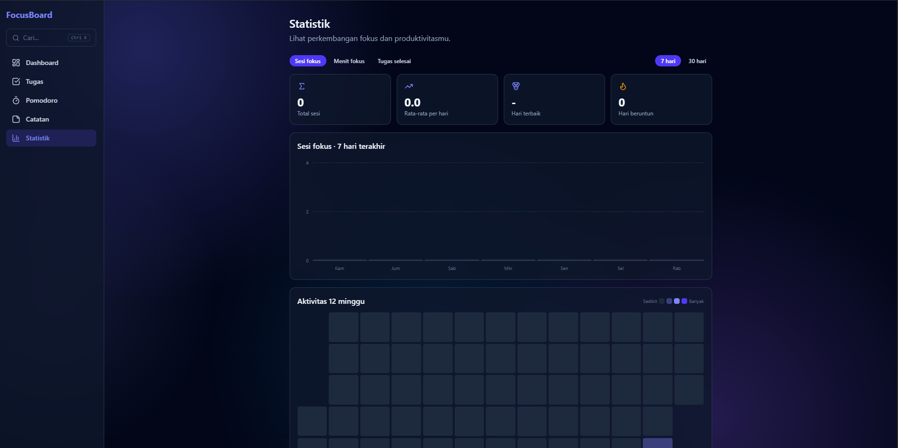
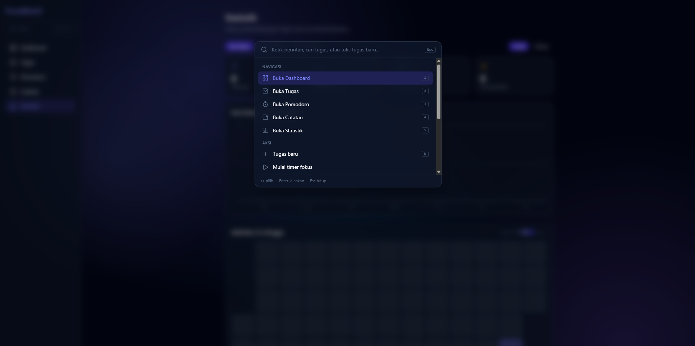
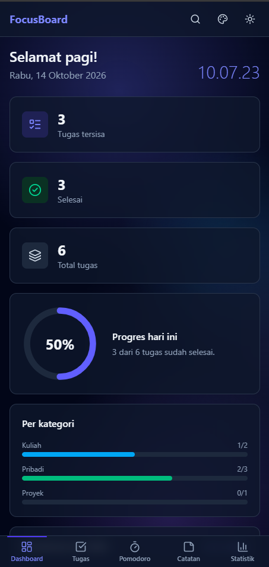

# FocusBoard

Dashboard produktivitas interaktif: kelola tugas, fokus dengan Pomodoro, catat ide, dan pantau perkembangan, semuanya dalam satu aplikasi web.

**Demo langsung:** https://productivity-dashboard-nu-one.vercel.app/
**Repositori:** https://github.com/esjeruk25/productivity-dashboard



## Fitur

**Tugas**
- Tambah, centang, edit (klik dua kali), dan hapus dengan opsi urungkan
- Kategori, prioritas, dan deadline dengan label otomatis (terlambat, hari ini, besok)
- Pencarian, filter status dan kategori
- Ubah urutan dengan drag and drop
- Konfeti saat semua tugas selesai

**Pomodoro**
- Timer fokus, istirahat, dan istirahat panjang dengan ring progres animasi
- Durasi dapat diatur, bunyi saat sesi selesai, dan timer tetap berjalan saat pindah halaman
- Pilih tugas yang sedang difokuskan, riwayat sesi harian tercatat

**Catatan**
- Kartu berwarna, sematkan, pencarian, dan editor yang mengembang dari kartu
- Tersimpan otomatis

**Statistik**
- Grafik batang interaktif (sesi fokus, menit fokus, tugas selesai) untuk 7 atau 30 hari
- Streak harian, heatmap aktivitas 12 minggu, dan sistem pencapaian dengan notifikasi

**Pengalaman pengguna**
- Loading screen interaktif, transisi halaman, dan animasi di seluruh aplikasi
- Mode gelap dan terang, latar belakang animasi (Aurora, Grid, Polos)
- Command Palette (`Ctrl + K`) dan pintasan keyboard
- Tampilan responsif dengan navigasi bawah di HP
- Ekspor, impor, dan reset data (JSON)

## Tangkapan layar

| Tugas | Pomodoro |
|---|---|
|  |  |

| Statistik | Command Palette |
|---|---|
|  |  |

| Mode gelap | Tampilan HP |
|---|---|
|  |  |

## Pintasan keyboard

| Tombol | Fungsi |
|---|---|
| `Ctrl/⌘ + K` | Buka Command Palette |
| `1` sampai `5` | Pindah halaman |
| `N` | Tugas baru |
| `D` | Ganti mode gelap/terang |
| `B` | Ganti gaya latar |
| `Spasi` | Mulai/jeda timer (halaman Pomodoro) |
| `?` | Bantuan pintasan |

## Teknologi

- [React](https://react.dev) + [Vite](https://vite.dev)
- [Tailwind CSS v4](https://tailwindcss.com)
- [Motion](https://motion.dev) untuk animasi
- [canvas-confetti](https://github.com/catdad/canvas-confetti) dan [lucide-react](https://lucide.dev)
- Penyimpanan di `localStorage` (tanpa backend)
- Deploy di [Vercel](https://vercel.com)

## Menjalankan di komputer sendiri

Butuh Node.js 20 atau lebih baru.

```bash
git clone https://github.com/esjeruk25/productivity-dashboard.git
cd productivity-dashboard
npm install
npm run dev
```

Buka alamat yang muncul (biasanya `http://localhost:5173`). Untuk build produksi: `npm run build`.

## Struktur proyek

```
src/
├── App.jsx                 # state utama, navigasi, pintasan global
├── components/             # halaman dan komponen UI
│   ├── Dashboard.jsx
│   ├── TaskPage.jsx
│   ├── PomodoroPage.jsx
│   ├── NotesPage.jsx
│   ├── StatsPage.jsx
│   ├── CommandPalette.jsx
│   ├── AnimatedBackground.jsx
│   └── ...
├── hooks/
│   ├── useLocalStorage.js  # useState yang tersimpan di browser
│   └── usePomodoro.js      # logika timer
└── utils/                  # fungsi bantu (deadline, statistik, backup)
```

## Penyimpanan data

Semua data tersimpan di browser (`localStorage`) dengan awalan `focusboard-`: tugas, catatan, sesi fokus, durasi, tema, latar, dan pencapaian. Data tidak dikirim ke server. Gunakan fitur ekspor di Command Palette untuk membuat cadangan.

## Keputusan teknis

- **State di `App.jsx`** dibagikan lewat props, sehingga Dashboard, Statistik, dan Command Palette memakai data yang sama (*lifting state up*).
- **Timer ada di hook di level `App`** agar tetap berjalan ketika pindah halaman.
- **Animasi memakai transform CSS dan Motion** agar ringan, dan dimatikan otomatis jika perangkat memakai pengaturan *reduce motion*.
- **Mode gelap** diterapkan dengan menukar variabel warna Tailwind, sehingga komponen tidak perlu diubah satu per satu.

## Proses pengembangan (11 hari)

| Hari | Pekerjaan |
|---|---|
| 1 | Setup React + Vite + Tailwind, deploy awal ke Vercel |
| 2 | To-do inti: tambah, centang, hapus, progress bar |
| 3 | Animasi tugas, kategori, prioritas, filter, edit langsung, konfeti |
| 4 | Loading screen, Dashboard, mode gelap, localStorage, Pomodoro, Catatan |
| 5 | Deadline, pencarian, drag and drop, urungkan hapus, tampilan HP |
| 6 | Halaman Statistik, streak, heatmap, pencapaian |
| 7 | Command Palette dan pintasan keyboard |
| 8 | Latar belakang animasi, ekspor dan impor data |
| 9 | <!-- sesuaikan dengan yang benar-benar dikerjakan --> Perbaikan dan penyempurnaan |
| 10 | Pengujian, rapikan kode, dokumentasi |
| 11 | Finalisasi, pengecekan deploy, persiapan demo |

Riwayat lengkap dapat dilihat di [daftar commit](https://github.com/esjeruk25/productivity-dashboard/commits/main).

## Catatan

Proyek ini dikembangkan dengan pendekatan *vibe coding* (dibantu AI) sesuai ketentuan tugas. Daftar pengujian manual ada di [docs/TESTING.md](docs/TESTING.md).

## Keterbatasan dan rencana lanjutan

- Data hanya ada di satu browser dan tidak tersinkron antar perangkat. Rencana: backend atau layanan sinkronisasi.
- Belum ada akun pengguna dan notifikasi di luar tab.
- Belum ada pengujian otomatis. Rencana: tes unit untuk fungsi statistik dan deadline.